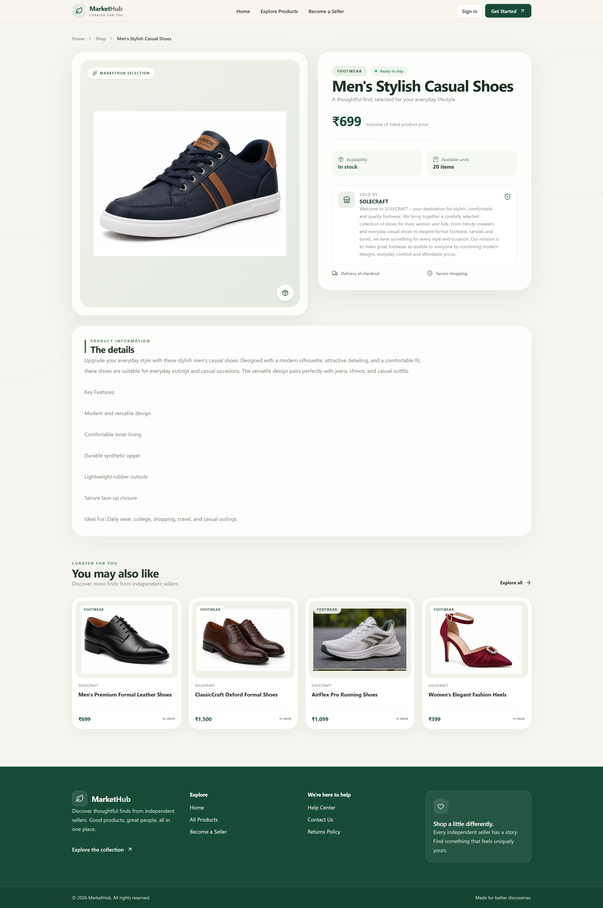
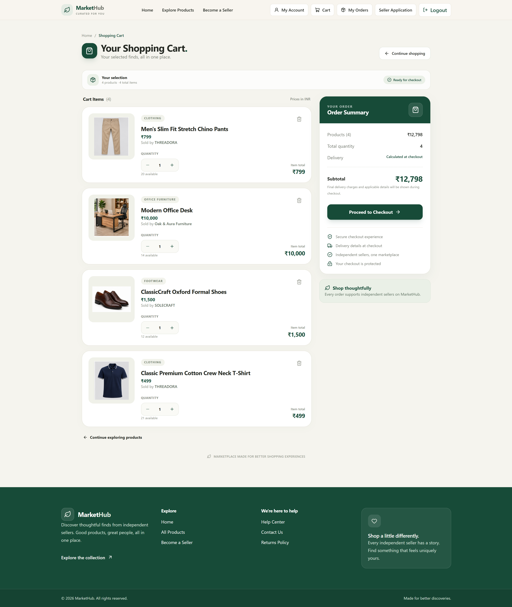
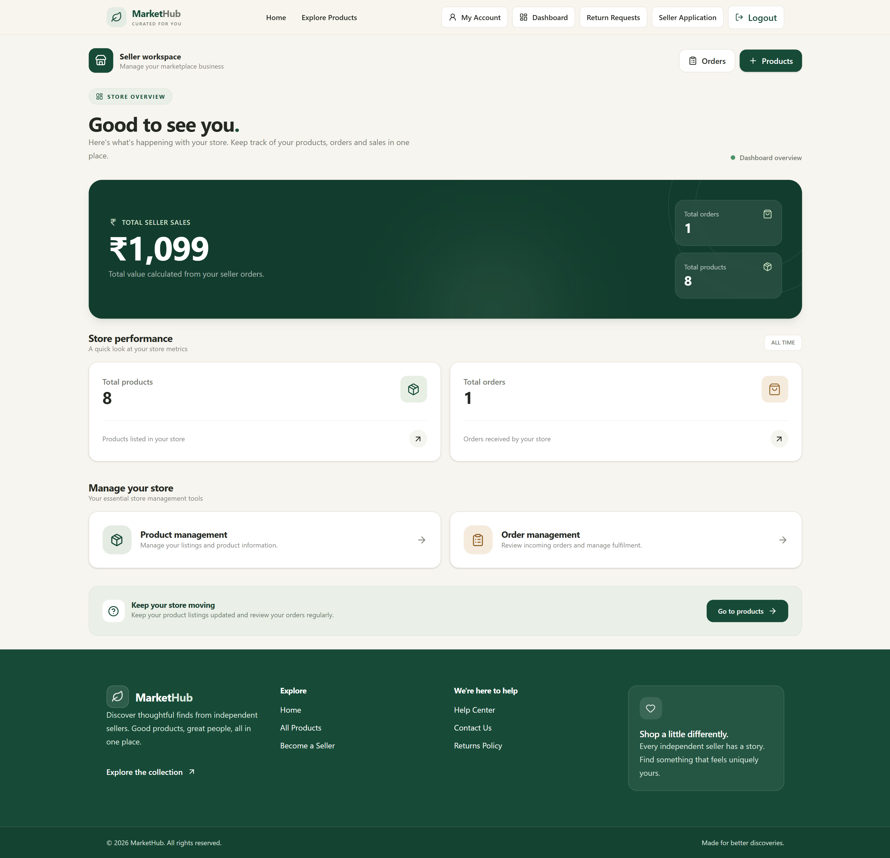
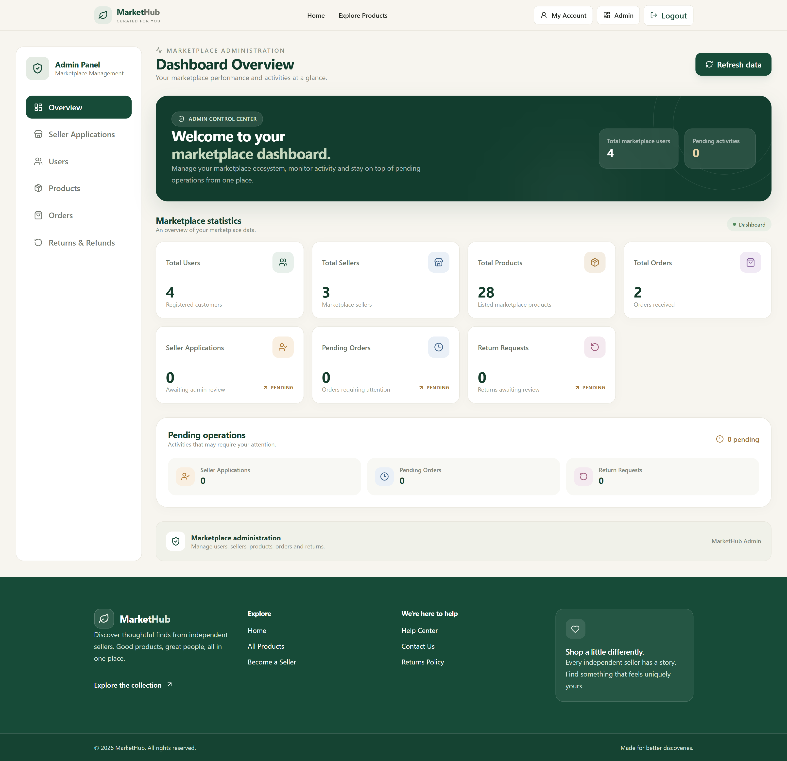

# MarketHub – Multi-Vendor E-Commerce Marketplace

A full-stack multi-vendor e-commerce marketplace built using the MERN stack. MarketHub allows buyers to explore products and place orders, sellers to manage their stores and products, and administrators to manage marketplace operations.

## Live Deployment

- **Frontend:** Deployed on Vercel
- **Backend API:** https://marketplace-l0pb.onrender.com
- **API Health Check:** https://marketplace-l0pb.onrender.com/api/health
- **GitHub Repository:** https://github.com/shanu1844/marketplace

## Features

### Buyer
- User registration and login
- Browse and search products
- Explore product categories
- View product details
- Add products to cart
- Update cart quantities and remove items
- Place orders
- Cash on Delivery and Razorpay payment options
- View order history and order details
- Cancel eligible order items
- Request returns and track return status

### Seller
- Submit seller application
- Track seller application status
- Create and manage a store
- Add, update, activate and deactivate products
- Manage seller orders
- Update individual order-item statuses
- Manage return requests
- Update refund information and refund status

### Admin
- View dashboard statistics
- Manage users
- View and manage marketplace products
- Activate, deactivate and delete products
- Review seller applications
- Approve or reject seller applications
- View orders and return requests
- Reconcile eligible Razorpay payment records

### Payment and Order Management
- Razorpay order creation and payment verification
- Razorpay webhook integration
- Payment reconciliation workflow
- Pending Razorpay payment expiry handling
- Stock restoration after eligible failed or expired payments
- Order-item-level status tracking
- Return and refund status tracking

**Refund note:** Razorpay refund functionality is implemented in the backend. Bank-transfer refunds are handled manually, with the refund reference recorded in the system.

## Technology Stack

### Frontend
- React
- Vite
- React Router
- Tailwind CSS v4
- Axios
- Framer Motion
- Lucide React
- React Hot Toast

### Backend
- Node.js
- Express.js
- MongoDB
- Mongoose
- JSON Web Token (JWT)
- bcryptjs
- Helmet
- Express Rate Limit
- Multer

### Integrations and Services
- Razorpay – Payment integration
- Cloudinary – Image storage
- Vercel – Frontend deployment
- Render – Backend deployment

## Project Structure

```text
marketplace/
│
├── client/
│   └── src/
│       ├── assets/
│       ├── components/
│       ├── context/
│       ├── pages/
│       ├── routes/
│       └── services/
│           └── api.js
│
├── server/
│   ├── config/
│   ├── controllers/
│   ├── jobs/
│   ├── middleware/
│   ├── models/
│   ├── routes/
│   ├── scripts/
│   ├── server.js
│   └── package.json
│
└── .gitignore
```

## Database Models

MarketHub uses MongoDB with Mongoose models.

| Model | Purpose |
|---|---|
| User | Buyer, seller and admin accounts |
| SellerApplication | Seller application and approval workflow |
| Store | Seller store information |
| Product | Product information and inventory |
| Cart | User shopping cart |
| Order | Orders, payments, returns and refunds |

## API Reference

Base URL:

```text
https://marketplace-l0pb.onrender.com
```

### Authentication – `/api/auth`

| Method | Endpoint | Access |
|---|---|---|
| POST | `/register` | Public |
| POST | `/login` | Public |
| GET | `/me` | Authenticated |

### Products – `/api/products`

| Method | Endpoint | Access |
|---|---|---|
| GET | `/public` | Public |
| GET | `/categories` | Public |
| GET | `/:productId` | Public |
| GET | `/my-products` | Seller |
| POST | `/` | Seller |
| PATCH | `/:productId` | Seller |
| PATCH | `/:productId/status` | Seller |
| DELETE | `/:productId` | Seller |

### Cart – `/api/cart`

| Method | Endpoint | Access |
|---|---|---|
| POST | `/` | Authenticated |
| GET | `/` | Authenticated |
| PATCH | `/quantity` | Authenticated |
| DELETE | `/` | Authenticated |
| DELETE | `/:productId` | Authenticated |

### Stores – `/api/stores`

| Method | Endpoint | Access |
|---|---|---|
| POST | `/` | Seller |
| GET | `/my-store` | Seller |
| PATCH | `/my-store` | Seller |
| PATCH | `/my-store/status` | Seller |

### Seller Applications – `/api/seller`

| Method | Endpoint | Access |
|---|---|---|
| POST | `/apply` | Authenticated |
| GET | `/my-application` | Authenticated |
| GET | `/applications` | Admin |
| PATCH | `/applications/:applicationId/status` | Admin |

### Orders – `/api/orders`

| Method | Endpoint | Access |
|---|---|---|
| POST | `/` | Authenticated |
| POST | `/razorpay/create-order` | Authenticated |
| POST | `/razorpay/verify-payment` | Authenticated |
| POST | `/razorpay/cancel-order` | Authenticated |
| POST | `/razorpay/reconcile-payment` | Admin |
| GET | `/my-orders` | Authenticated |
| GET | `/:orderId` | Authenticated |
| PATCH | `/:orderId/items/:itemId/cancel` | Authenticated |
| PATCH | `/:orderId/items/:itemId/return` | Authenticated |
| GET | `/seller/my-orders` | Seller |
| GET | `/seller/return-requests` | Seller |
| PATCH | `/seller/:orderId/items/:itemId/status` | Seller |
| PATCH | `/seller/:orderId/items/:itemId/payment` | Seller |
| PATCH | `/seller/:orderId/items/:itemId/return` | Seller |
| PATCH | `/seller/:orderId/items/:itemId/return-received` | Seller |
| PATCH | `/seller/:orderId/items/:itemId/refund` | Seller |
| PATCH | `/:orderId/items/:itemId/refund-details` | Authenticated |
| POST | `/seller/:orderId/items/:itemId/razorpay-refund` | Seller |

### Admin – `/api/admin`

| Method | Endpoint | Access |
|---|---|---|
| GET | `/dashboard/stats` | Admin |
| GET | `/users` | Admin |
| GET | `/products` | Admin |
| PATCH | `/products/:productId/status` | Admin |
| DELETE | `/products/:productId` | Admin |
| GET | `/orders` | Admin |
| GET | `/returns` | Admin |

### Razorpay Webhook

| Method | Endpoint | Purpose |
|---|---|---|
| POST | `/api/webhooks/razorpay` | Razorpay payment webhook |

All protected routes require JWT authentication. Seller and admin routes additionally enforce role-based authorization where configured.

## Payment Expiry and Stock Management

MarketHub includes a scheduled job for handling pending Razorpay orders.

- Pending payment expiry threshold: 15 minutes.
- Scheduler execution interval: Every 5 minutes.
- Checks Razorpay payment attempts before releasing reserved stock.
- Restores stock when there are no payment attempts or all attempts have explicitly failed.
- Skips orders requiring payment reconciliation.
- Uses MongoDB transactions for the relevant order and inventory updates.

## Getting Started

### Prerequisites

Install the following:

- Node.js
- npm
- MongoDB database
- Git

### 1. Clone the repository

```bash
git clone https://github.com/shanu1844/marketplace.git
cd marketplace
```

### 2. Install frontend dependencies

```bash
cd client
npm install
```

### 3. Install backend dependencies

Open another terminal:

```bash
cd server
npm install
```

### 4. Configure environment variables

Create a `.env` file inside the `server` directory using `.env.example` as a reference.

Backend environment variables:

```env
PORT=5000
MONGODB_URI=your_mongodb_connection_string
JWT_SECRET=your_jwt_secret

CLOUDINARY_CLOUD_NAME=your_cloudinary_cloud_name
CLOUDINARY_API_KEY=your_cloudinary_api_key
CLOUDINARY_API_SECRET=your_cloudinary_api_secret

RAZORPAY_KEY_ID=your_razorpay_key_id
RAZORPAY_KEY_SECRET=your_razorpay_key_secret
RAZORPAY_WEBHOOK_SECRET=your_razorpay_webhook_secret

CLIENT_URL=http://localhost:5173
```

Create a `.env` file inside the `client` directory:

```env
VITE_API_URL=http://localhost:5000/api
```

For production, configure `VITE_API_URL` with your deployed backend API base URL.

**Important:** Never commit `.env` files, API keys, database credentials or other secrets to GitHub.

### 5. Run the backend

```bash
cd server
npm run dev
```

Backend default URL:

```text
http://localhost:5000
```

### 6. Run the frontend

```bash
cd client
npm run dev
```

Frontend default URL:

```text
http://localhost:5173
```

## Deployment

### Frontend – Vercel

1. Import the GitHub repository into Vercel.
2. Set the Root Directory to `client`.
3. Configure the production environment variable:

```env
VITE_API_URL=https://marketplace-l0pb.onrender.com/api
```

4. Deploy the frontend.

### Backend – Render

1. Create a Web Service on Render.
2. Set the Root Directory to `server`.
3. Configure the build command:

```bash
npm install
```

4. Configure the start command:

```bash
npm start
```

5. Add the required backend environment variables in Render.
6. Set `CLIENT_URL` to the deployed frontend origin.
7. Deploy the backend and verify:

```text
https://marketplace-l0pb.onrender.com/api/health
```

## Screenshots

### Home Page


### Products


### Product Details


### Cart


### Seller Dashboard


### Admin Dashboard


## Security

- JWT-based authentication
- Password hashing with bcryptjs
- Role-based access control
- Helmet security middleware
- CORS configuration
- Environment-based secret management
- Git ignore rules for environment files and build outputs

## Future Improvements

Potential improvements for future releases:

- Automated bank refund integration
- Expanded marketplace analytics
- Additional automated testing
- Improved notification workflows

## Author

**Shailendra Choudhary**

MERN Stack Developer

- GitHub: https://github.com/shanu1844

---

If you find this project useful, consider giving the repository a ⭐ on GitHub.